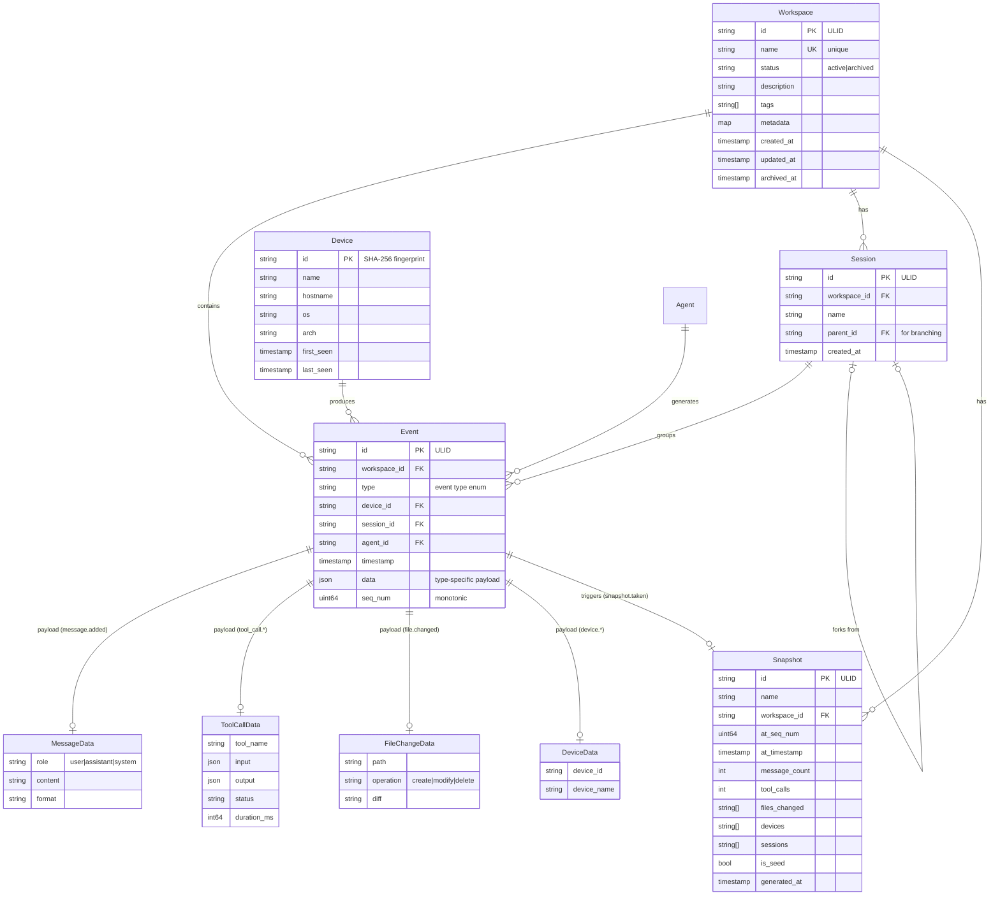

# WSM Entity Relationship Diagram

## Mermaid ERD



## Relationship Summary

### Primary Relationships

| From | To | Cardinality | Description |
|------|-----|-------------|-------------|
| Workspace | Event | 1:N | A workspace contains many events |
| Workspace | Session | 1:N | A workspace has many sessions |
| Workspace | Snapshot | 1:N | A workspace has many snapshots |
| Session | Event | 1:N | A session groups many events |
| Session | Session | 0..1:0..N | Sessions can fork (parent-child) |
| Device | Event | 1:N | A device produces many events |

### Event Payload Polymorphism

Events carry type-specific payloads in the `data` JSON field:

| Event Type | Payload Type | Key Fields |
|------------|--------------|------------|
| `message.added` | MessageData | role, content, format |
| `tool_call.started` | ToolCallData | tool_name, input |
| `tool_call.completed` | ToolCallData | tool_name, output, status, duration |
| `file.changed` | FileChangeData | path, operation, diff |
| `device.attached` | DeviceData | device_id, device_name |
| `device.detached` | DeviceData | device_id |
| `workspace.*` | object | type-specific metadata |

## Data Flow

```
┌─────────────┐     ┌─────────────┐     ┌─────────────┐
│   Device    │────▶│   Events    │────▶│  Workspace  │
│  (produce)  │     │  (append)   │     │  (contains) │
└─────────────┘     └──────┬──────┘     └──────┬──────┘
                          │                   │
                          ▼                   ▼
                   ┌─────────────┐     ┌─────────────┐
                   │   Session   │     │  Snapshot   │
                   │   (group)   │     │ (materialize)│
                   └─────────────┘     └─────────────┘
```

## Storage Schema (SQLite)

```sql
-- Simplified representation
CREATE TABLE workspaces (
    id TEXT PRIMARY KEY,
    name TEXT UNIQUE NOT NULL,
    status TEXT NOT NULL DEFAULT 'active',
    description TEXT,
    tags TEXT,  -- JSON array
    metadata TEXT,  -- JSON object
    created_at TEXT NOT NULL,
    updated_at TEXT NOT NULL,
    archived_at TEXT
);

CREATE TABLE events (
    id TEXT PRIMARY KEY,
    workspace_id TEXT NOT NULL REFERENCES workspaces(id),
    type TEXT NOT NULL,
    device_id TEXT,
    session_id TEXT,
    agent_id TEXT,
    timestamp TEXT NOT NULL,
    data TEXT,  -- JSON payload
    seq_num INTEGER NOT NULL,
    UNIQUE(workspace_id, seq_num)
);

CREATE TABLE snapshots (
    id TEXT PRIMARY KEY,
    name TEXT,
    workspace_id TEXT NOT NULL REFERENCES workspaces(id),
    at_seq_num INTEGER NOT NULL,
    at_timestamp TEXT NOT NULL,
    workspace_json TEXT NOT NULL,  -- Serialized workspace state
    message_count INTEGER DEFAULT 0,
    tool_calls INTEGER DEFAULT 0,
    files_changed TEXT,  -- JSON array
    devices TEXT,  -- JSON array
    sessions TEXT,  -- JSON array
    is_seed INTEGER DEFAULT 0,
    generated_at TEXT NOT NULL
);

CREATE TABLE devices (
    id TEXT PRIMARY KEY,
    name TEXT NOT NULL,
    hostname TEXT NOT NULL,
    os TEXT NOT NULL,
    arch TEXT NOT NULL,
    first_seen TEXT NOT NULL,
    last_seen TEXT NOT NULL
);

CREATE INDEX idx_events_workspace ON events(workspace_id, seq_num);
CREATE INDEX idx_events_session ON events(session_id);
CREATE INDEX idx_events_type ON events(workspace_id, type);
CREATE INDEX idx_snapshots_workspace ON snapshots(workspace_id, at_seq_num DESC);
```
