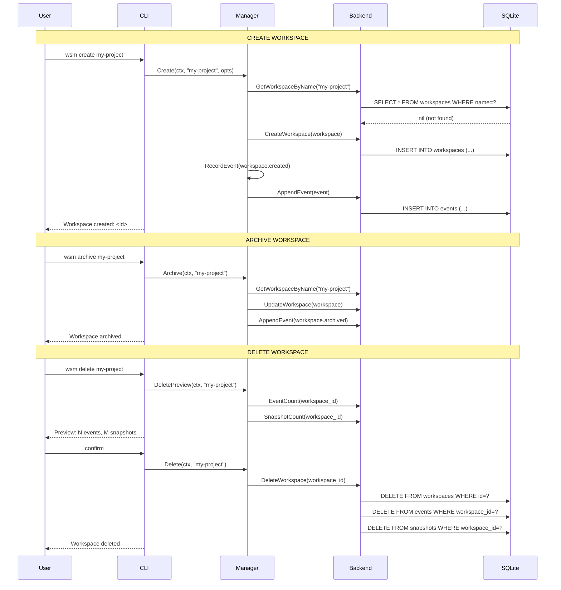
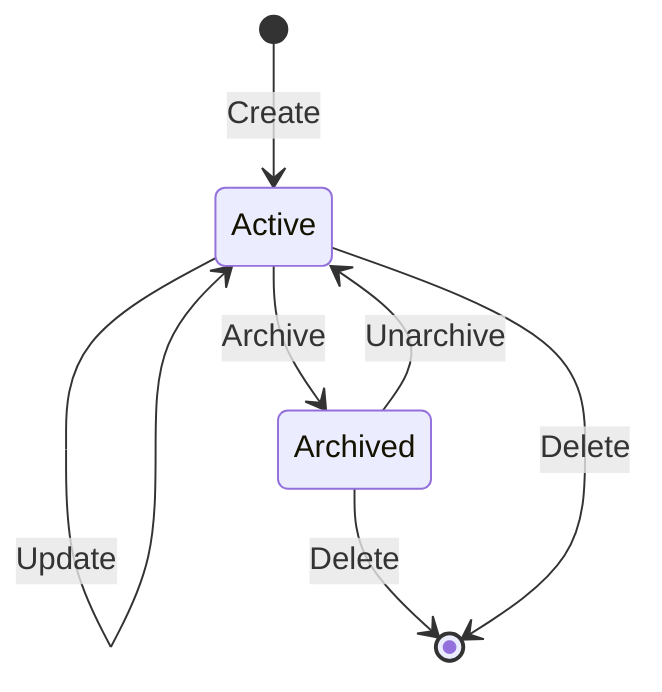
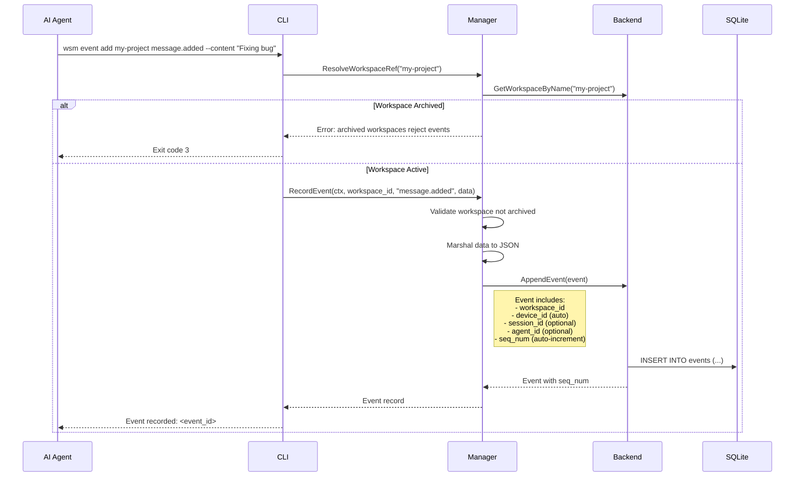
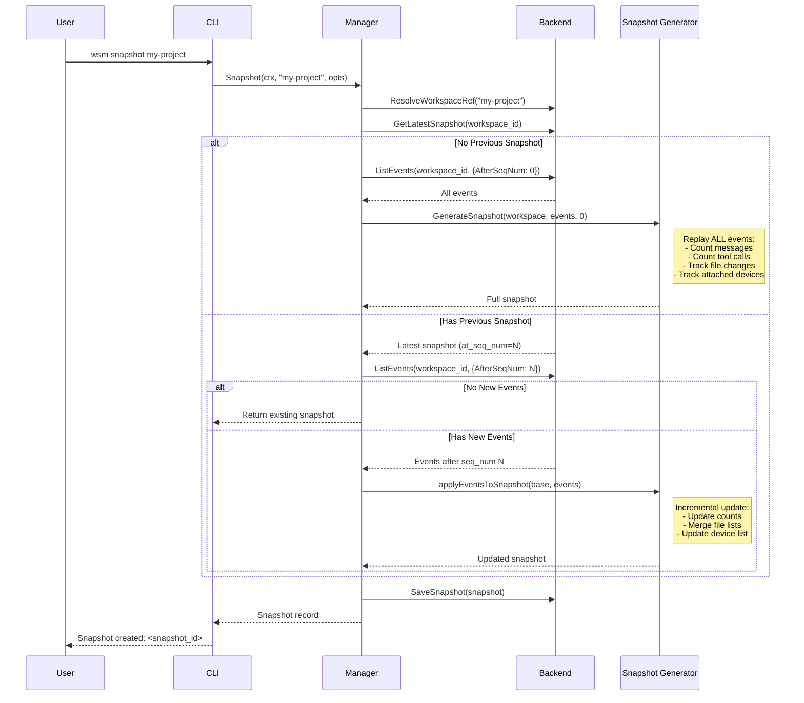
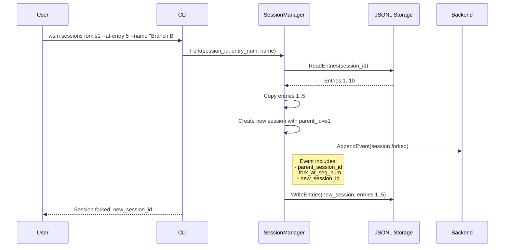
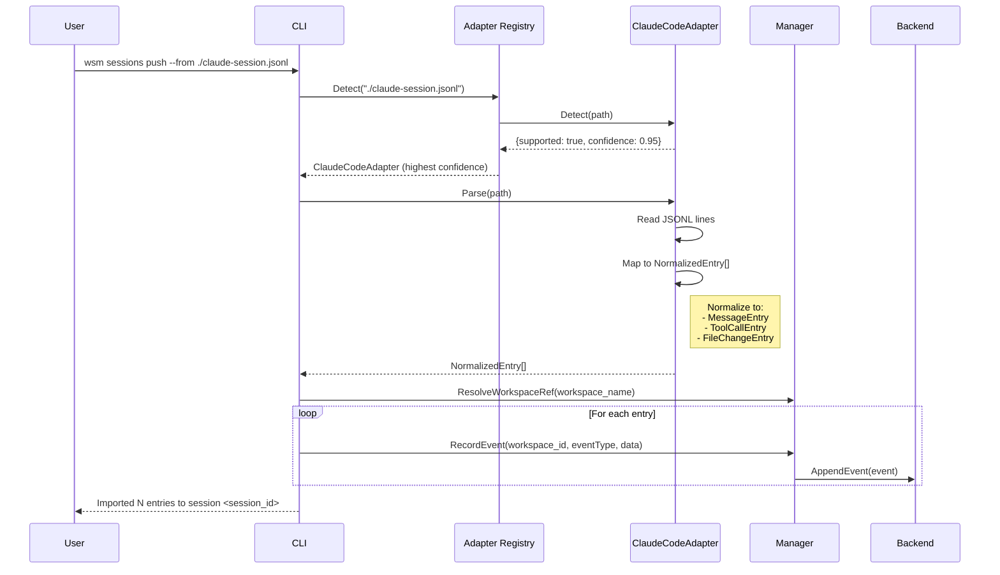
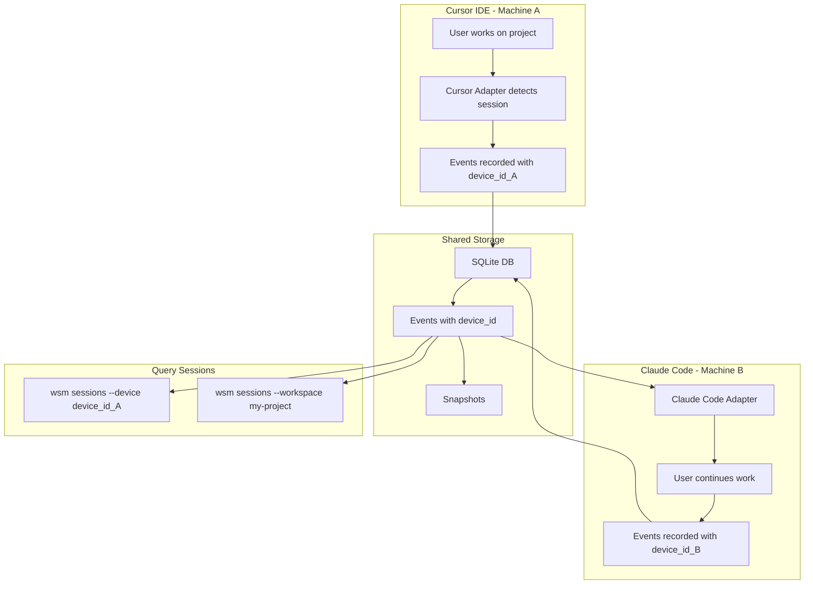
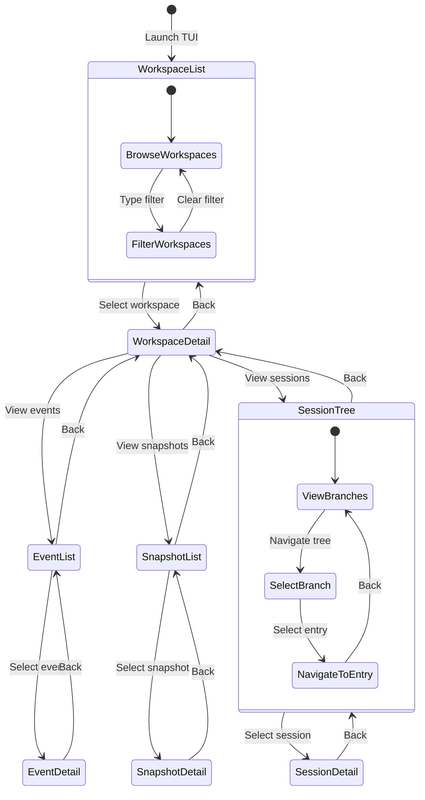
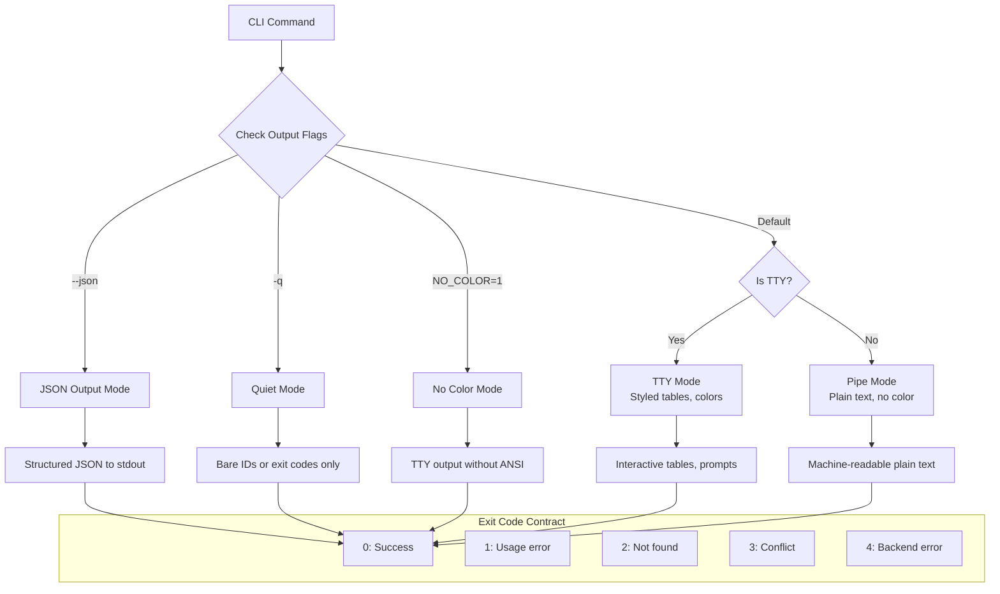
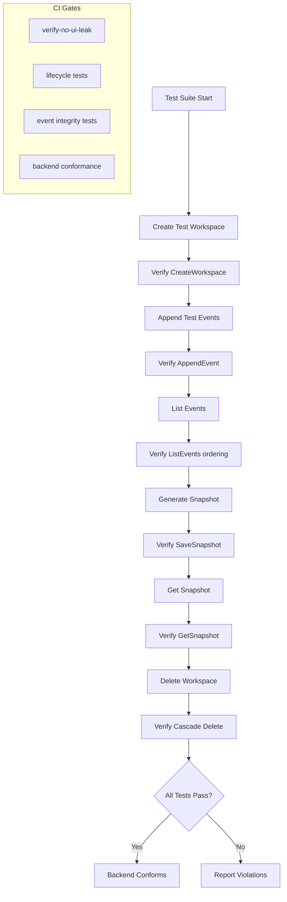

# WSM Flow Diagrams

## 1. Workspace Lifecycle Flow

### Sequence Diagram



### State Diagram



## 2. Event Recording Flow



## 3. Snapshot Generation Flow



## 4. Device Auto-Detection Flow

```mermaid
flowchart TD
    A[Manager.NewManager] --> B[device.Current]
    B --> C[Collect System Info]
    C --> D[runtime.GOOS]
    C --> E[runtime.GOARCH]
    C --> F[os.Hostname]
    
    D --> G[Build Machine Key]
    E --> G
    F --> G
    
    G --> H["SHA-256(OS|Arch|Hostname)"]
    H --> I[Device{ID, Name, Hostname, OS, Arch}]
    
    I --> J[Backend.SaveDevice]
    J --> K[Persist to DB]
    
    K --> L[Manager Ready]
    
    L --> M[All events include device_id]
```

## 5. Session Forking Flow



## 6. Format Adapter Import Flow



## 7. Cross-IDE Session Continuity Flow



## 8. TUI Navigation Flow



## 9. Output Mode Selection Flow



## 10. Backend Conformance Test Flow


