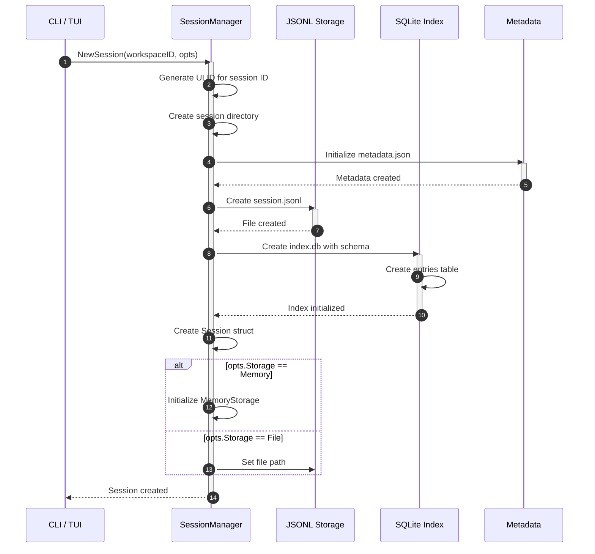
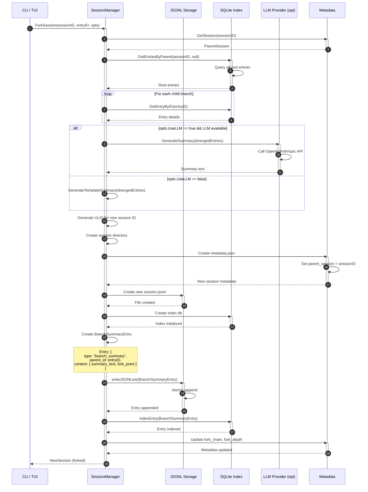
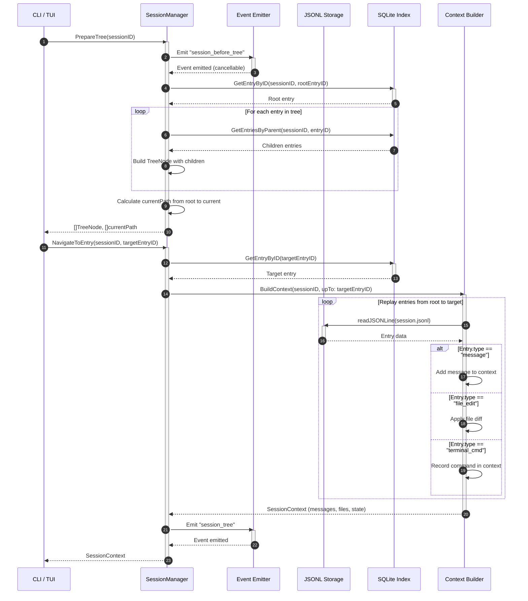
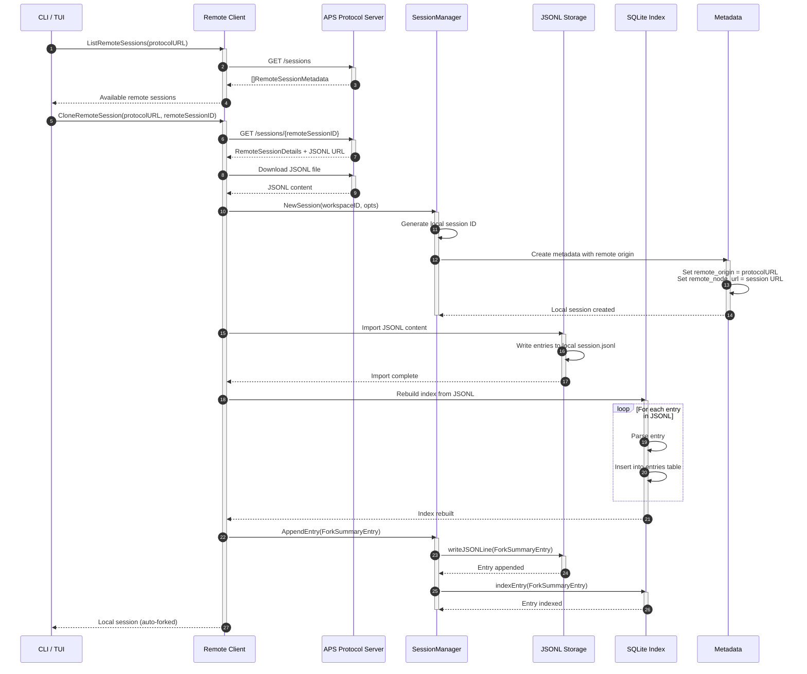
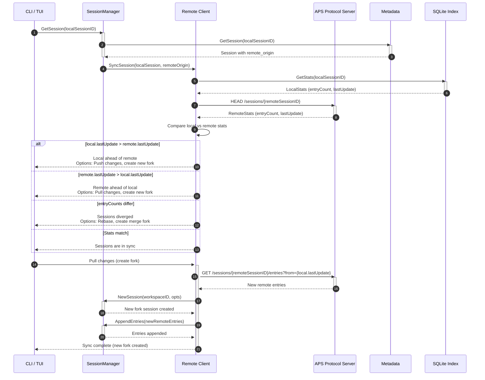

# Session Management Sequence Diagrams

This document contains sequence diagrams for the session management feature.

## Table of Contents

1. [Session Create](#session-create)
2. [Session Fork](#session-fork)
3. [Tree Navigation](#tree-navigation)
4. [One-Level Rebase](#one-level-rebase)
5. [Recursive Rebase](#recursive-rebase)
6. [Clone Remote Session](#clone-remote-session)
7. [Session Sync](#session-sync)

---

## Session Create



---

## Session Fork



---

## Tree Navigation



---

## One-Level Rebase

```mermaid
sequenceDiagram
    autonumber
    participant CLI as CLI / TUI
    participant SM as SessionManager
    participant IDX as SQLite Index
    participant JSONL as JSONL Storage
    participant CONFLICT as Conflict Resolver
    participant META as Metadata

    CLI->>SM: RebaseWithChild(parentID, childID)
    activate SM

    %% Step 1: Verify child is immediate fork of parent
    SM->>META: GetSession(parentID)
    activate META
    META-->>SM: ParentSession
    deactivate META

    SM->>META: GetSession(childID)
    activate META
    META-->>SM: ChildSession
    deactivate META

    SM->>SM: Validate: Child.parent_session == parentID

    %% Step 2: Get diverged entries
    SM->>IDX: GetEntriesByParent(parentID, child.forkPoint)
    activate IDX
    IDX-->>SM: Parent's diverged entries
    deactivate IDX

    SM->>IDX: GetEntriesByParent(childID, child.forkPoint)
    activate IDX
    IDX-->>SM: Child's diverged entries
    deactivate IDX

    %% Step 3: Detect conflicts
    SM->>CONFLICT: DetectConflicts(parentEntries, childEntries)
    activate CONFLICT

    loop Compare entries
        CONFLICT->>CONFLICT: Check file path conflicts
        CONFLICT->>CONFLICT: Check message conflicts
    end

    alt Conflicts found
        CONFLICT-->>SM: ConflictReport
        deactivate CONFLICT

        %% Prompt user for resolution
        SM->>CLI: Show conflict report
        CLI-->>SM: Resolution choice (keep-parent|keep-child|merge-manual)
    else No conflicts
        CONFLICT-->>SM: No conflicts
        deactivate CONFLICT
    end

    %% Step 4: Apply rebase
    alt Resolution == keep-child
        SM->>JSONL: Append child entries to parent
        activate JSONL
        loop For each child entry
            JSONL->>JSONL: Atomic append
        end
        JSONL-->>SM: Entries appended
        deactivate JSONL

        SM->>IDX: Index appended entries
        activate IDX
        IDX-->>SM: Entries indexed
        deactivate IDX
    else Resolution == keep-parent
        SM->>SM: Skip child entries
    else Resolution == merge-manual
        SM->>SM: User merges manually
        SM->>JSONL: Append merged entries
        activate JSONL
        JSONL-->>SM: Merged entries
        deactivate JSONL
    end

    %% Step 5: Create rebase summary entry
    SM->>SM: Create RebaseSummaryEntry
    Note over SM: Entry: {<br/>  type: "rebase_summary",<br/>  content: { rebase_from, rebase_to, conflicts_resolved }<br/>}

    SM->>JSONL: writeJSONLine(RebaseSummaryEntry)
    activate JSONL
    JSONL-->>SM: Entry appended
    deactivate JSONL

    SM->>IDX: indexEntry(RebaseSummaryEntry)
    activate IDX
    IDX-->>SM: Entry indexed
    deactivate IDX

    %% Step 6: Update fork pointers
    SM->>META: Update parent fork pointer
    activate META
    META->>META: Set last_fork_from = childID
    META-->>SM: Metadata updated
    deactivate META

    SM-->>CLI: Rebase complete
    deactivate SM
```

---

## Recursive Rebase

```mermaid
sequenceDiagram
    autonumber
    participant CLI as CLI / TUI
    participant SM as SessionManager
    participant CHAIN as Fork Chain Tracker
    participant IDX as SQLite Index
    participant REBASE as One-Level Rebase

    CLI->>SM: RecursiveRebase(sessionID, targetID)
    activate SM

    %% Step 1: Build fork chain
    SM->>CHAIN: GetForkChain(sessionID)
    activate CHAIN

    loop Walk up parent chain
        CHAIN->>IDX: GetSession(parentID)
        activate IDX
        IDX-->>CHAIN: Session
        deactivate IDX

        CHAIN->>CHAIN: Add to chain
    end

    CHAIN-->>SM: ForkChain [sessionID, parent1, parent2, ..., root]
    deactivate CHAIN

    %% Step 2: Find rebase path
    SM->>SM: Check if targetID is in fork chain

    alt targetID == immediate child
        SM->>REBASE: RebaseWithChild(sessionID, targetID)
        activate REBASE
        REBASE-->>SM: Rebase complete
        deactivate REBASE
    else targetID is deeper in chain
        %% Recursive rebase through intermediate parents
        SM->>SM: Identify intermediate parents between sessionID and targetID

        loop For each intermediate parent
            SM->>REBASE: RebaseWithChild(parent, child)
            activate REBASE
            REBASE-->>SM: Rebase complete
            deactivate REBASE

            alt Conflicts detected
                SM->>CLI: Report conflict and pause
                CLI-->>SM: Continue or abort
            end
        end
    else targetID not in chain
        SM-->>CLI: Error: targetID not reachable
        deactivate SM
    end

    %% Step 3: Final summary
    SM->>SM: Generate rebase summary
    SM-->>CLI: Recursive rebase complete
    deactivate SM
```

---

## Clone Remote Session



---

## Session Sync


